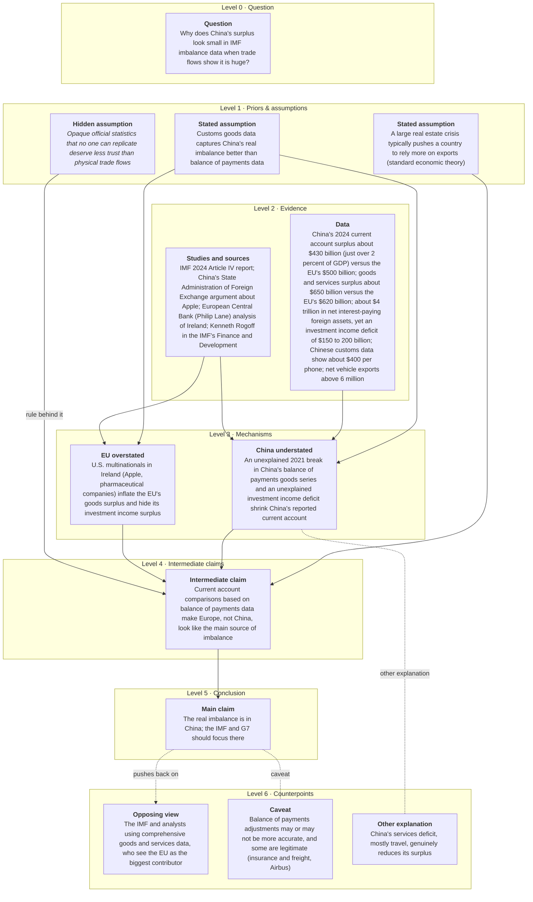

# Worked example: China's Stealth Trade Surplus

*One article from prose to a citation, in seven panels.*

`PROCESS.md` says what each step decides. This walks one article through
all of them, so the claim that a question can be answered the way this
analyst reasons can be checked rather than taken.

The article is 1,179 words of prose about a discrepancy between two
statistical sources. By the end of this document it is 13 claims, 18
links and 57 subject labels, and one of those claims is something Setser
never wrote down.

Read it with the published article open. Every paragraph reference below
is to the numbered paragraphs of the live page, and the whole point of
keeping the corpus at twenty articles is that a person can check this.

|           |                                                            |
| --------- | ---------------------------------------------------------- |
| Article   | **China's Stealth Trade Surplus**                          |
| Author    | Brad W. Setser - CFR Follow the Money                      |
| Published | 2025-07-07                                                 |
| Source    | https://www.cfr.org/articles/chinas-stealth-trade-surplus  |
| Map       | `mermaid_code/setser_2025-07-07_china-stealth-surplus.mmd` |
| Cited as  | `setser_2025-07-07_china-stealth-surplus#<node_id>`        |

The article runs 1179 words over 29 paragraphs, with 7 figures and 13 inline references. The map reduces it to **13 claims and 18 links**. Everything below is either generated from `data/` or marked as hand-written.

---

## Panel 1 - The article, as the annotator sees it

`cfr_extract.py` numbers the paragraphs. Those numbers are the only handle anything downstream has on the prose, so a paragraph is the unit a passage link points at.

| para | words | claims linked    | grade               | shared literals                   |
| ---- | ----- | ---------------- | ------------------- | --------------------------------- |
| p1   | 10    | -                | -                   | -                                 |
| p2   | 13    | -                | -                   | -                                 |
| p3   | 42    | `E1`             | anchored            | `6million`                        |
| p4   | 25    | -                | -                   | -                                 |
| p5   | 10    | -                | -                   | -                                 |
| p6   | 32    | `P1`             | candidate           | -                                 |
| p7   | 16    | `P3`             | candidate           | -                                 |
| p8   | 56    | `E1`             | anchored            | `430billion` `500billion`         |
| p9   | 28    | `X`              | candidate           | -                                 |
| p10  | 9     | -                | -                   | -                                 |
| p11  | 43    | -                | -                   | -                                 |
| p12  | 53    | `QF`             | candidate           | -                                 |
| p13  | 52    | `E2`, `M2`       | anchored            | `apple` `ireland`                 |
| p14  | 30    | -                | -                   | -                                 |
| p15  | 18    | -                | -                   | -                                 |
| p16  | 88    | `E1`             | anchored            | `400`                             |
| p17  | 27    | `R1`             | candidate           | -                                 |
| p18  | 77    | -                | -                   | -                                 |
| p19  | 55    | `Q`              | candidate           | -                                 |
| p20  | 23    | `E1`             | anchored            | `620billion` `650billion`         |
| p21  | 4     | -                | -                   | -                                 |
| p22  | 28    | -                | -                   | -                                 |
| p23  | 17    | -                | -                   | -                                 |
| p24  | 96    | `E1`             | anchored            | `150` `200billion` `4trillion`    |
| p25  | 26    | `C1`, `M1`       | candidate           | -                                 |
| p26  | 157   | `E2`, `M2`, `P2` | anchored, candidate | `apple` `ireland` `lane` `philip` |
| p27  | 49    | -                | -                   | -                                 |
| p28  | 33    | -                | -                   | -                                 |
| p29  | 59    | -                | -                   | -                                 |
**14 of 29 paragraphs carry a claim.** The other 15 (p1, p2, p4, p5, p10, p11, p14, p15, p18, p21, p22, p23, p27, p28, p29) are not lost in any sense that matters - see panel 2.

---
## Panel 2 - The reading pass *(hand-written)*

**This is the only panel a script does not produce.** It is written by a person in `scripts/worked_example_notes.yaml`; code may propose, never overwrite.

It is also deliberately not a story about what the annotator was thinking. Each note gives the paragraph, the claim and the rule in `schema_map.yaml` that the role answers to, so a reader can disagree with the fit rather than take it on trust.

### `Q` - question

> Why does China's surplus look small in IMF imbalance data when trade flows show it is huge?

- **p19** - candidate, abstracts
  > Such adjustments may (or may not) paint a more accurate picture of ...

The question node is the annotator's statement of what the article is
for, and it is the one node with no obligation to match a sentence.
p7 is the pivot the article actually turns on - *"Yet that surplus
often seems to disappear when it comes to the statistics on global
imbalances"* - and the question is that sentence turned round.

The linker proposed p19 instead, at 0.271. p19 restates the puzzle
late, after the resolution is already in view. **Review item:** p7 is
the better home.

### `P1` - stated assumption

> A large real estate crisis typically pushes a country to rely more on exports (standard economic theory)

- **p6** - candidate, abstracts
  > Moreover, it maps to standard economic theory: a large real estate crisis ...

Stated, in so many words, in p6: *"it maps to standard economic theory:
a large real estate crisis typically leads countries to rely more on
exports."* He asserts it and does not defend it, which is what
`stated_assumption` means in `schema_map.yaml` - stated, not argued.

Worth noticing what grade it got. At 0.694 this is the strongest
semantic match in the article, and it is still `candidate`, because
claim and paragraph share no *distinctive* literal - "exports",
"crisis" and "theory" are everywhere in this corpus. The grading is
deliberately conservative: `anchored` is a claim about provenance, and
a paraphrase, however good, is not provenance.

### `P2` - stated assumption

> Customs goods data captures China's real imbalance better than balance of payments data

- **p26** - candidate, abstracts
  > There is pretty good case to be made, though, that the real ...

p26: *"the real imbalance these days is all in China - and that is its
captured better in the customs data than the balance of payments
data."* The node is that sentence with the hedge removed.

It is graded `candidate / abstracts` at 0.442. **Review item:** this
one is close to a quotation and `states` is the better relation. It
missed `anchored` for the same reason `P1` did - every token it shares
with p26 (customs, data, balance, payments) recurs across the corpus,
so none of them is distinctive enough to anchor on. Two of the
article's clearest claim-to-sentence matches are the two the literal
test cannot see.

### `P3` - hidden assumption

> Opaque official statistics that no one can replicate deserve less trust than physical trade flows

- **p7** - candidate, presupposes
  > Yet that surplus often seems to disappear when it comes to the ...

**This is the node the method exists for.** Nothing in the article
says it. p26 states the *fact* - *"China's data has become much more
opaque over time; no one can replicate China's new balance of payments
goods series"* - but the step from that fact to *therefore prefer the
customs data* is never taken out loud. It is the warrant in Toulmin's
sense, and `hidden_assumption` is the role for a premise the argument
needs and the author does not supply.

Two things follow, and they pull in opposite directions.

It is why the graph answers questions a quote-extractor cannot. "What
does he assume, without defending, about China?" has an answer here,
and no search over the text of this article would return it.

It is also the weakest provenance in the article, and the document
should not pretend otherwise. The linker offered p7 at 0.193 with the
relation `presupposes`, which is the right *relation* and probably the
wrong paragraph. **Review item:** p26 is where the premise comes
closest to the surface.

### `E1` - evidence data

> China's 2024 current account surplus about $430 billion (just over 2 percent of GDP) versus the EU's $500 billion; goods and services surplus about $650 billion versus the EU's $620 billion; about $4 trillion in net interest-paying foreign assets, yet an investment income deficit of $150 to 200 billion; Chinese customs data show about $400 per phone; net vehicle exports above 6 million

- **p3** - anchored, states, shared literals `6million`
- **p8** - anchored, states, shared literals `430billion 500billion`
- **p16** - anchored, states, shared literals `400`
- **p20** - anchored, states, shared literals `620billion 650billion`
- **p24** - anchored, states, shared literals `150 200billion 4trillion`

**A claim is not a span of text.** The figures are scattered through
the article because Setser introduces each where he needs it; they do
one job in the argument, so they are one node. Five paragraphs are
linked and all five are `anchored` - one per clause of the claim:
p8 ($430bn against $500bn), p20 ($650bn against $620bn), p24 ($4tn of
interest-paying assets against a $150-200bn income deficit), p16
($400 a phone) and p3 (6 million vehicles).

This is the cleanest demonstration of what `anchored` buys. The grade
is not a similarity score that cleared a threshold; it is the
observation that this claim and that paragraph share a string a
reader can search for.

**It read three until 2026-10-28, and finding the other two is what
this document was for.** Reading the claim text against the citation
table showed two clauses with no paragraph under them - *"about $400
per phone"* and *"net vehicle exports above 6 million"* - both in the
article, both carrying the distinctive figure. Six paragraphs
qualified as `anchored` for `E1`; three were written.

The cause generalises, which is why it was worth chasing: a relative
score floor (`>= 0.6 x best`) is a **relevance** filter, and it was
being applied to a **provenance** signal. For an aggregate evidence
node the paragraph supplying the fifth figure always scores low on
cosine - p16 scores 0.106 against p8's 0.429 - because the claim text
is dominated by the other four, while the figure it shares is exactly
as distinctive as theirs.

The floor is gone from `link_passages.py` and the anchor test was
tightened to compensate; `scripts/README.md` has the corpus numbers
and the threshold sweep.

### `E2` - evidence source

> IMF 2024 Article IV report; China's State Administration of Foreign Exchange argument about Apple; European Central Bank (Philip Lane) analysis of Ireland; Kenneth Rogoff in the IMF's Finance and Development

- **p13** - anchored, states, shared literals `apple ireland`
- **p26** - anchored, states, shared literals `apple ireland lane philip`

The sources node: the IMF's 2024 Article IV, SAFE's argument about
Apple, Philip Lane and the ECB on Ireland, Rogoff in Finance and
Development. Anchored to p26 on `apple ireland lane philip`.

`evidence_source` and `evidence_data` are separate roles because they
fail differently. A number can be revised; a source can be
mischaracterised. Keeping them apart is what lets a later question ask
which of his conclusions rest on IMF publications - which is a real
query over `data_basis`, and `E2` carries `imf-publications` and
`academic-econometrics` for exactly that reason.

### `M1` - mechanism

> An unexplained 2021 break in China's balance of payments goods series and an unexplained investment income deficit shrink China's reported current account

- **p25** - candidate, abstracts
  > The overall result is that the EU reported a bigger current account ...

The first of the two mechanisms, and the role came from the `classDef`
rather than the bold line: the annotator used the bold slot for a name
("China understated") instead of a template role, and `class M1 mech`
caught it. This is the case `schema_map.yaml` resolves in priority
order - header, then class, then level - and 2 of 13 roles here land
on the second try.

Its substance is p14 (*"China hasn't really explained why its balance
of payments goods surplus tumbled in 2021"*) plus p23 and p24 on the
income deficit, strengthened by p15 and p16, where the one explanation
offered - SAFE's story about Apple's phone pricing - is checked
against the customs data and fails.

The linker put it on p25, the paragraph that states the *result*.
**Review item:** p14 is the mechanism; p25 is what the mechanism
produces.

### `M2` - mechanism

> U.S. multinationals in Ireland (Apple, pharmaceutical companies) inflate the EU's goods surplus and hide its investment income surplus

- **p13** - anchored, states, shared literals `apple ireland`
- **p26** - anchored, states, shared literals `apple ireland`

The mirror mechanism, anchored twice on `apple ireland` - p13 for the
goods leg and p26 for the income leg.

The pair `M1` and `M2` is the structure of the whole article: the gap
between the two data sources is overstatement at one end and
understatement at the other, and both have to hold for `C1` to follow.
They are drawn as two nodes rather than one because they are
independently attackable - `R1` undercuts `M1` and leaves `M2`
standing.

### `C1` - intermediate claim

> Current account comparisons based on balance of payments data make Europe, not China, look like the main source of imbalance

- **p25** - candidate, abstracts
  > The overall result is that the EU reported a bigger current account ...

p25: *"The overall result is that the EU reported a bigger current
account surplus than China in 2024, and that's what enters into the
IMF's standard analysis."* `intermediate_claim` because it is not
where the article lands - it is the thing that has to be true before
the main claim is interesting.

Its subject labels invert the article's: `euro-area` as subject,
`china` as counterpart. That is correct and worth seeing. `C1` is a
claim about how Europe looks in the data, stated so that `K` can
overturn the comparison.

### `K` - main claim

> The real imbalance is in China; the IMF and G7 should focus there

- *No paragraph link at all.*

The main claim, and until 2026-10-28 the place where the anchor test
embarrassed itself.

It was graded `anchored` to p28 on the shared literal `7` - the
digit, plucked out of "G7" by a figure pattern with no left word
boundary. Formally distinctive, substantively nothing, and it was the
main claim of the article citing a paragraph on a numeral. Its score,
0.101, was the lowest of the sixteen links and said so.

That is now fixed at source: a lookbehind stops a number being read
out of the middle of a name, so `G7`, `COVID-19` and `A321` no longer
produce figures. Nothing replaced the link, and **`K` is now `none`**
- which is the honest answer. Its real home is p26 and p27 together,
p26 making the case that the imbalance is in China and p27 asking
whether the IMF will act on it, and the matcher reaches neither
because the claim abstracts both rather than restating either.

**Review item:** `K` needs a hand-assigned passage. A main claim with
no citable paragraph is the normal case in this corpus, not a defect
- the conclusion of an argument is rarely a sentence in it.

### `X` - opposing view

> The IMF and analysts using comprehensive goods and services data, who see the EU as the biggest contributor

- **p9** - candidate, abstracts
  > So Europe, not China, seems to be the biggest contributor to global ...

The opposing view, and it is Setser's own characterisation of it:
p9 (*"So Europe, not China, seems to be the biggest contributor to
global imbalances. That, at least, is what is implied by the data sets
used by the IMF"*) and p18, where the analysts who use the broad data
are described rather more sharply.

`K --rebuts--> X`, signed -1, drawn with a label the annotator wrote
("pushes back on"). The sign is argumentative, not causal: it does not
mean the main claim makes the opposing view smaller, it means the main
claim is aimed at it.

### `QF` - caveat

> Balance of payments adjustments may or may not be more accurate, and some are legitimate (insurance and freight, Airbus)

- **p12** - candidate, abstracts
  > Now, there are reasons why goods trade in the balance of payments ...

The caveat, from p12 - the BoP-to-customs adjustments are not all
distortion, and the main one, insurance and freight, is modest and
legitimate - and from p29, the Airbus footnote, which the node's own
text names. Only p12 is linked.

`K --qualified_by--> QF` is a dashed edge the annotator labelled
"caveat", signed -1. The caveat is in the map because it is in the
article: a map that recorded only the load-bearing claims would make
this analyst look more certain than he is, and the concessions are
part of how he argues.

### `R1` - other explanation

> China's services deficit, mostly travel, genuinely reduces its surplus

- **p17** - candidate, abstracts
  > And, of course, services (in China’s case, essentially travel to Hong Kong ...

p17: *"services (in China's case, essentially travel to Hong Kong and
Southeast Asia) further reduce China's goods and services surplus."*
A rival explanation for part of the gap, conceded in passing.

`M1 --undercut_by--> R1`, signed -1, labelled "other explanation" in
the map. Note where it attaches: to the mechanism, not to the main
claim. Setser is granting that some of China's lower reported surplus
is real, which weakens the understatement story without touching the
conclusion - and the graph records the difference, because the edge
lands on `M1`.

### What the map leaves out

Sixteen of the twenty-nine paragraphs carry no passage link, and it is
worth being precise about what that means, because "the map throws away
half the article" and "the map keeps everything that argues" are very
different claims.

**Four are connective tissue.** p2 ("That basic statement maps to a host
of well-known and easily verified realities"), p10 ("But something is
lost in translation so to speak"), p11 and p21 ("Now consider investment
income") move the reader between sections. They assert nothing that
could be supported or attacked.

**Four illustrate a premise the article does not argue for.** p1, p3, p4
and p5 - the surplus has soared, autos, renewables, export volume growth.
Setser is not defending these; he is establishing that the thing to be
explained is real. The map puts that work in `Q`, which is what a Level 0
question node is for.

**Eight are content the map does represent, and the passage linker did
not connect.** p14, p15 and p16 are the whole SAFE-and-Apple rebuttal
that makes the 2021 break *unexplained* rather than merely unexplained-
to-me; that is `M1`'s substance and `M1` is linked to p25 instead. p22
and p23 are the investment income detail behind `M1` and `M2`. p18 is
the characterisation of analysts that `X` abstracts. p27 is half of `K`.
p29 is the Airbus footnote named in `QF`'s own text.

That last group is the honest number: **eight paragraphs of argument the
graph holds but cannot cite**, because the node text abstracts the
paragraph instead of quoting it, and `link_passages.py` ranks on shared
wording. It is a retrieval gap, not a modelling gap - the claim is in
the graph either way - but it is the gap, and `--full-text` plus a human
pass over `passage_review.yaml` is what closes it.

---

## Panel 3 - The map

The authored artifact. Code never rewrites this file. The theme config and the `classDef` styling are dropped here for legibility; nothing else is changed.



---

## Panel 4 - Parse: what was read, what was declared

`parse_maps.py` turns the map into rows. Every row records *how it was known*, and that column matters more than the content does.

### Claims

| id | role | level | slot label | claim | how the role was known |
|---|---|---|---|---|---|
| `Q` | question | L0 | Question | Why does China's surplus look small in IMF imbalance data when trade flows show it is huge? | read - the map's own bold slot label |
| `P1` | stated_assumption | L1 | Stated assumption | A large real estate crisis typically pushes a country to rely more on exports (standard economic theory) | read - the map's own bold slot label |
| `P2` | stated_assumption | L1 | Stated assumption | Customs goods data captures China's real imbalance better than balance of payments data | read - the map's own bold slot label |
| `P3` | hidden_assumption | L1 | Hidden assumption | Opaque official statistics that no one can replicate deserve less trust than physical trade flows | read - the map's own bold slot label |
| `E1` | evidence_data | L2 | Data | China's 2024 current account surplus about $430 billion (just over 2 percent of GDP) versus the EU's $500 ... | read - the map's own bold slot label |
| `E2` | evidence_source | L2 | Studies and sources | IMF 2024 Article IV report; China's State Administration of Foreign Exchange argument about Apple; European Central Bank (Philip ... | read - the map's own bold slot label |
| `M1` | mechanism | L3 | China understated | An unexplained 2021 break in China's balance of payments goods series and an unexplained investment income deficit shrink ... | read - the classDef assigned in the map |
| `M2` | mechanism | L3 | EU overstated | U.S. multinationals in Ireland (Apple, pharmaceutical companies) inflate the EU's goods surplus and hide its investment income surplus | read - the classDef assigned in the map |
| `C1` | intermediate_claim | L4 | Intermediate claim | Current account comparisons based on balance of payments data make Europe, not China, look like the main source ... | read - the map's own bold slot label |
| `K` | main_claim | L5 | Main claim | The real imbalance is in China; the IMF and G7 should focus there | read - the map's own bold slot label |
| `X` | opposing_view | L6 | Opposing view | The IMF and analysts using comprehensive goods and services data, who see the EU as the biggest contributor | read - the map's own bold slot label |
| `QF` | caveat | L6 | Caveat | Balance of payments adjustments may or may not be more accurate, and some are legitimate (insurance and freight, ... | read - the map's own bold slot label |
| `R1` | other_explanation | L6 | Other explanation | China's services deficit, mostly travel, genuinely reduces its surplus | read - the map's own bold slot label |

Role provenance: **11** header, **2** class.

Note the fourth column. This is a `meta` template, so the claim sits in the node body and the bold line holds the role name. The three templates disagree about this, and an analysis that reads one field without checking `family` reads notes rather than claims for most of the corpus.

### Links

| from | to | relation | how the relation was known |
|---|---|---|---|
| `P1` | `C1` | supports | declared - a bare solid arrow, taken as support |
| `P2` | `M1` | supports | declared - a bare solid arrow, taken as support |
| `P2` | `M2` | supports | declared - a bare solid arrow, taken as support |
| `E1` | `M1` | supports | declared - a bare solid arrow, taken as support |
| `E2` | `M1` | supports | declared - a bare solid arrow, taken as support |
| `E2` | `M2` | supports | declared - a bare solid arrow, taken as support |
| `M1` | `C1` | supports | declared - a bare solid arrow, taken as support |
| `M2` | `C1` | supports | declared - a bare solid arrow, taken as support |
| `P3` | `C1` | licenses | read - the annotator wrote this on the arrow |
| `C1` | `K` | supports | declared - a bare solid arrow, taken as support |
| `K` | `X` | rebuts | read - the annotator wrote this on the arrow |
| `K` | `QF` | qualified_by | read - the annotator wrote this on the arrow |
| `M1` | `R1` | undercut_by | read - the annotator wrote this on the arrow |
| `Q` | `P1` | frames | declared - an invisible `~~~` connector, taken as framing |
| `Q` | `P2` | frames | declared - an invisible `~~~` connector, taken as framing |
| `Q` | `P3` | frames | declared - an invisible `~~~` connector, taken as framing |
| `P1` | `E1` | frames | declared - an invisible `~~~` connector, taken as framing |
| `P3` | `E2` | frames | declared - an invisible `~~~` connector, taken as framing |

Relation provenance: **9** arrow, **5** layout_operator, **4** label.

The declared ones are a convention, not a reading. A bare arrow is taken as support because in the thirteen maps that label selectively, all 49 written labels are non-support - leaving a link bare is the annotator's shorthand for the ordinary case. `~~~` is layout, so it is signed 0 and cannot inflate a support count.

---

## Panel 5 - The subject axis

`label_facets.py` assigns terms from the closed vocabulary in `facets.yaml`. The allowed values compile into the response schema at run time, so an off-list term is a validation failure rather than a quiet new tag.

| claim | country | data_basis | variable |
|---|---|---|---|
| `Q` | `china` *(subject)* | `imf-publications` | `current-account`, `global-imbalances` |
| `P1` | `china` *(subject)* | - | `domestic-demand`, `export-volumes` |
| `P2` | `china` *(subject)* | `balance-of-payments`, `customs` | `current-account`, `goods-trade-balance` |
| `P3` | `china` *(subject)* | `balance-of-payments`, `customs` | `current-account` |
| `E1` | `euro-area` *(counterpart)*, `china` *(subject)* | `balance-of-payments` | `current-account`, `goods-trade-balance`, `investment-income-balance` |
| `E2` | `ireland` *(subject)* | `academic-econometrics`, `imf-publications` | `current-account`, `investment-income-balance` |
| `M1` | `china` *(subject)* | `balance-of-payments` | `current-account`, `investment-income-balance` |
| `M2` | `euro-area` *(counterpart)*, `ireland` *(subject)* | `balance-of-payments` | `goods-trade-balance`, `investment-income-balance` |
| `C1` | `china` *(counterpart)*, `euro-area` *(subject)* | `balance-of-payments` | `current-account`, `global-imbalances` |
| `K` | `china` *(subject)* | `imf-publications` | `current-account`, `global-imbalances` |
| `X` | `china` *(counterpart)*, `euro-area` *(subject)* | `imf-publications` | `current-account`, `global-imbalances` |
| `QF` | `china` *(subject)* | `balance-of-payments` | `current-account`, `goods-trade-balance` |
| `R1` | `china` *(subject)* | - | `current-account`, `services-balance` |

57 labels over 3 facets, **57** llm.

`subject` against `counterpart` is what makes a claim bilateral: `china`, `euro-area`, `ireland` as subject, `china`, `euro-area` as counterpart, direction preserved.

---

## Panel 6 - Derived: signs and indices

No edge is signed by hand; the sign is a function of the relation. It is **argumentative, not causal** - `+1` backs, `-1` pushes back, `0` defers. It does not mean increases or decreases.

| sign | reading | links |
|---|---|---|
| `1` | backs | 10 |
| `0` | defers | 5 |
| `-1` | pushes back on | 3 |

The negative links are the author arguing against his own case: `K` to `X`, `K` to `QF`, `M1` to `R1`.

| index | value | what it means here |
|---|---|---|
| variables | 13 | claims in the map |
| connections | 18 | links |
| density | 0.1154 | share of possible links drawn |
| hierarchy index | 0.0609 | star-ness, **not** layeredness - near zero is the correct reading |
| mean centrality | 2.77 | links per claim |

Node character: **1** transmitter, **9** ordinary, **3** receiver. Transmitters are what the argument rests on; receivers are where it lands.

---

## Panel 7 - One claim, cited

Of 18 passage links on this article, **9 are `anchored`**: the claim and the paragraph share a distinctive literal, which is provenance. The rest are `candidate` - semantic overlap only, a narrowing from 29 paragraphs to one, and the vault never renders one as a source.

A further **1** claim(s) matched no paragraph at all. That is a row in the data, graded `none`, not a gap in it.

| | |
|---|---|
| Claim | `setser_2025-07-07_china-stealth-surplus#E1` |
| Role | evidence_data |
| Text | China's 2024 current account surplus about $430 billion (just over 2 percent of GDP) versus the EU's $500 billion; goods and services surplus about $650 billion versus the EU's $620 billion; about $4 trillion in net interest-paying foreign assets, yet an investment income deficit of $150 to 200 billion; Chinese customs data show about $400 per phone; net vehicle exports above 6 million |
| Published at | https://www.cfr.org/articles/chinas-stealth-trade-surplus |

It rests on **5 paragraph(s)**, each sharing a distinctive literal with the claim:

| paragraph | relation | score | shared literals |
|---|---|---|---|
| p8 | `states` | 0.429 | `430billion 500billion` |
| p20 | `states` | 0.413 | `620billion 650billion` |
| p24 | `states` | 0.366 | `150 200billion 4trillion` |
| p3 | `states` | 0.233 | `6million` |
| p16 | `states` | 0.106 | `400` |

The literals are why this is a citation and not a guess: those tokens occur in the claim, in that paragraph, and in few other paragraphs of this article. Open the URL, find the paragraph, check it.

**One claim is not one paragraph.** An evidence node that gathers figures from across an article is cited by every paragraph it gathers from, and a citation line that showed only the best-scoring one would misrepresent the claim as narrower than it is.

The full chain for any claim on this article:

```
python scripts/trace.py setser_2025-07-07_china-stealth-surplus#Q
```

### What this example shows, and what it does not

**What it shows.** Thirteen claims, each with a role read off the map
and a subject from a closed vocabulary, linked by eighteen relations of
which four were written by hand and fourteen take a declared convention
that cannot inflate a support count. One claim, `P3`, is a premise the
argument needs and the article never states - and it is the one that
makes the cross-article question answerable.

**What it does not show.** That the fourteen declared relations are
right - they are a convention, chosen on evidence, which is a different
thing. That the subject labels are right - all 57 came from a model
session and every row says so. That another annotator would draw this
map; no article in the corpus has two independent annotations, so the
agreement harness has nothing to measure.

**What it turned up, and what came of it.** Reading the panels against
each other found six things. Four are still open and are verdicts for
`passage_review.yaml`, which does not exist yet: `Q`, `P3` and `M1` sit
on the wrong paragraph, and `P2` has the wrong relation.

The other two were the same bug from both ends, and both are fixed.
`K` was `anchored` on the digit 7, pulled out of "G7"; `E1` was cited
by three paragraphs where six qualified. The anchor test was admitting
tokens that are distinctive by document frequency and meaningless as
identifiers - a bare numeral, `!states` and `!united`, `!covid-` and
`19`, a word capitalised only because it opened a sentence - and a
relative score floor was then discarding a third of all anchored pairs
to compensate. Tightening what may anchor let the floor come off.
Corpus-wide the effect was 92 anchored rows to 115, and the numbers and
the threshold sweep are in `scripts/README.md`.

Six claims that previously reached an anchor no longer do, `K` among
them. That is the change working rather than failing: their only anchor
was a shared percentage, and a claim with an honest `none` is worth
more than a claim with a citation that does not survive being checked.

---

## The other worked examples

The same seven panels over a different article, which is the only way to tell what is the method and what is one article:

- **Not One Emerging Market Financial Crisis, but Many** — `python scripts/worked_example.py --doc setser_mar_31_20`

---

*Panels 1 and 3-7 are generated by `scripts/worked_example.py --doc setser_2025-07-07_china-stealth-surplus`. Panel 2 is hand-written in `scripts/worked_example_notes.yaml`. Regenerate after any pipeline run so the numbers cannot drift.*
