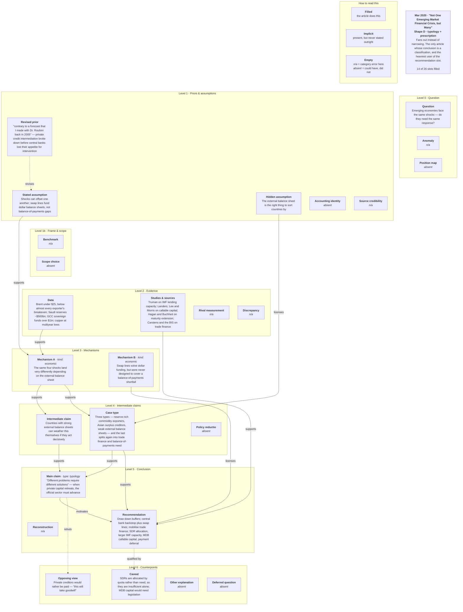

# Worked example: Not One Emerging Market Financial Crisis, but Many

*One article from prose to a citation, in seven panels.*

The first worked example is one analyst's own map of his own article.
This is the control: a different annotator, a different template, and
an argument with a different shape.

It is also the article that best shows what the passage matcher is
for. Four of its claims are sourced to a named person - Truman,
Carstens, Buchheit, Landers - and a name is the one thing a paraphrase
cannot lose.

| | |
|---|---|
| Article | **Not One Emerging Market Financial Crisis, but Many** |
| Author | — |
| Published | 2020-03-31 |
| Source | https://www.cfr.org/articles/not-one-emerging-market-financial-crisis-many |
| Map | `mermaid_code/setser_mar_31_20.mmd` |
| Cited as | `setser_mar_31_20#<node_id>` |

The article runs 2007 words over 36 paragraphs, with 1 figure and 22 inline references. The map reduces it to **14 claims and 14 links**. Everything below is either generated from `data/` or marked as hand-written.

---

## Panel 1 - The article, as the annotator sees it

`cfr_extract.py` numbers the paragraphs. Those numbers are the only handle anything downstream has on the prose, so a paragraph is the unit a passage link points at.

| para | words | claims linked | grade | shared literals |
|---|---|---|---|---|
| p1 | 13 | - | - | - |
| p2 | 78 | `E1` | anchored | `25` |
| p3 | 39 | - | - | - |
| p4 | 15 | - | - | - |
| p5 | 62 | - | - | - |
| p6 | 74 | - | - | - |
| p7 | 8 | `Q` | candidate | - |
| p8 | 16 | - | - | - |
| p9 | 20 | - | - | - |
| p10 | 107 | `E1` | anchored | `1trillion` `500billion` |
| p11 | 85 | - | - | - |
| p12 | 60 | - | - | - |
| p13 | 107 | - | - | - |
| p14 | 114 | `C1`, `P1` | candidate | - |
| p15 | 58 | `P2` | candidate | - |
| p16 | 11 | - | - | - |
| p17 | 24 | `C2` | candidate | - |
| p18 | 57 | - | - | - |
| p19 | 15 | `K` | candidate | - |
| p20 | 78 | `E2` | anchored | `bis` `carstens` |
| p21 | 46 | - | - | - |
| p22 | 30 | - | - | - |
| p23 | 30 | - | - | - |
| p24 | 96 | `QF`, `REC` | anchored | `sdr` `sdrs` |
| p25 | 35 | `QF`, `REC` | anchored | `sdr` `sdrs` |
| p26 | 35 | `E2` | anchored | `truman` |
| p27 | 43 | `E2` | anchored | `landers` `lee` `morris` |
| p28 | 110 | `E2`, `X` | anchored, candidate | `buchheit` `hagan` `lee` |
| p29 | 22 | - | - | - |
| p30 | 57 | - | - | - |
| p31 | 16 | - | - | - |
| p32 | 146 | - | - | - |
| p33 | 136 | `P3` | anchored | `2005` |
| p34 | 43 | - | - | - |
| p35 | 93 | - | - | - |
| p36 | 24 | - | - | - |

**14 of 36 paragraphs carry a claim.** The other 22 (p1, p3, p4, p5, p6, p8, p9, p11, p12, p13, p16, p18, p21, p22, p23, p29, p30, p31, p32, p34, p35, p36) are not lost in any sense that matters - see panel 2.

---

## Panel 2 - The reading pass *(hand-written)*

**This is the only panel a script does not produce.** It is written by a person in `scripts/worked_example_notes.yaml`; code may propose, never overwrite.

It is also deliberately not a story about what the annotator was thinking. Each note gives the paragraph, the claim and the rule in `schema_map.yaml` that the role answers to, so a reader can disagree with the fit rather than take it on trust.

### `Q` - question

> Emerging economies face the same shocks — do they need the same response?

- **p7** - candidate, abstracts
  > These shocks will touch almost all emerging economies.

The framing question, and the one the title answers. `candidate` to
p7, where the four shocks are enumerated.

### `P1` - stated assumption

> Shocks can offset one another; swap lines fund dollar balance sheets, not balance-of-payments gaps

- **p14** - candidate, abstracts
  > Countries with strong external balance sheets consequently can weather the storm if ...

Two assertions in one slot - shocks can offset one another, and swap
lines fund dollar balance sheets rather than balance-of-payments
gaps. The second is doing the work: it is what makes `M2` possible.

**Review item** on its own terms. A node carrying two claims cannot
be attacked separately, and the half the argument leans on is the
second one.

### `P2` - hidden assumption

> The external balance sheet is the right thing to sort countries by

- **p15** - candidate, presupposes
  > The more difficult and pressing problems arise among countries around the world ...

The hidden assumption, and the same shape as `P3` in the first
example: the article never argues that the external balance sheet is
the right thing to sort countries by, it just sorts by it.
Everything downstream - `M1`, `C2`, the whole typology - depends on
that choice.

`presupposes` against p15, which is the right relation. The second
article running in which the hidden assumption is the load-bearing
node.

### `P3` - revised prior

> "contrary to a forecast that I made with Dr. Roubini back in 2005" — private credit intermediation broke down before central banks lost their appetite for intervention

- **p33** - anchored, states, shared literals `2005`

**The role that is genuinely ours.** `revised_prior` is one of the
two types sitting outside Toulmin's six elements - a change of mind
across articles rather than a move inside this argument - and this
is a clean instance: *"contrary to a forecast that I made with Dr.
Roubini back in 2005"*.

`anchored` to p33 on the literal `2005`. Note what kind of anchor
that is. A bare year is the same class of token that produced the
`7`-from-"G7" problem in the first example; it survives the
tightened test because it appears in only two articles and because
the claim names the year itself. It is right here, and it is the
residual risk of that family. **Review item:** confirm p33 carries
the revision rather than merely sharing the date.

### `E1` - evidence data

> Brent under $25, below almost every exporter's breakeven; Saudi reserves ~$500bn; GCC sovereign funds over $1tn; copper at multiyear lows

- **p2** - anchored, states, shared literals `25`
- **p10** - anchored, states, shared literals `1trillion 500billion`

Four figures from the commodity shock - Brent under $25, Saudi
reserves around $500bn, GCC sovereign funds over $1tn, copper at
multiyear lows. Anchored to p2 and p10.

### `E2` - evidence source

> Truman on IMF lending capacity; Landers, Lee and Morris on callable capital; Hagan and Buchheit on maturity extension; Carstens and the BIS on trade finance

- **p20** - anchored, states, shared literals `bis carstens`
- **p26** - anchored, states, shared literals `truman`
- **p27** - anchored, states, shared literals `landers lee morris`
- **p28** - anchored, states, shared literals `buchheit hagan lee`

**The best anchoring in the corpus, and the clearest case for the
change made on 2026-10-28.** Four paragraphs, four separate anchors,
every one a surname: Truman on IMF lending capacity (p26), Landers,
Lee and Morris on callable capital (p27), Hagan and Buchheit on
maturity extension (p28), Carstens and the BIS on trade finance
(p20).

Two of those four were being discarded before the change. `!bis
!carstens` and `!buchheit !hagan !lee` are in the measured list of
anchors the old relative score floor threw away, for the same reason
`E1` lost its fifth figure in the first example: a sources node's
text is dominated by whichever name scores highest, and the rest
fall below `0.6 x best` while being exactly as distinctive.

A surname is the strongest anchor there is. It survives paraphrase,
it is rare by construction, and a reader confirms it in one search.

### `M1` - mechanism

> The same four shocks land very differently depending on the external balance sheet

- *No paragraph link at all.*

The sorting mechanism - the same four shocks land very differently
depending on the external balance sheet.

**No paragraph at all**, graded `none`, and so is `M2`. Both of this
article's mechanisms are unlinked, which matches `M1` in the first
example and is worth treating as a finding rather than a
coincidence: a mechanism is usually built across a run of paragraphs
and restated in none of them, so a matcher ranking on shared wording
has nothing to lock onto.

### `M2` - mechanism

> Swap lines solve dollar funding, but were never designed to cover a balance-of-payments shortfall

- *No paragraph link at all.*

Swap lines solve dollar funding and were never designed to cover a
balance-of-payments shortfall. `none`, as above.

This is `P1`'s second clause promoted to a mechanism, which is the
other reason to split `P1`.

### `C1` - intermediate claim

> Countries with strong external balance sheets can weather this themselves if they act decisively

- **p14** - candidate, abstracts
  > Countries with strong external balance sheets consequently can weather the storm if ...

Countries with strong external balance sheets can weather this
themselves if they act decisively. `candidate` to p14.

### `C2` - case type

> Three types — reserve-rich commodity exporters, Asian surplus creditors, weak external balance sheets — and the last splits again into trade finance and balance-of-payments need

- **p17** - candidate, abstracts
  > 1) Funding trade receivables: i.e. trade finance or the funding needs from ...

`case_type`, and the reason this article has a different shape from
the first. Three types, the last splitting again - the conclusion
**fans out** instead of narrowing. The map's own banner says as
much: *"the only article whose conclusion is a classification"*.

### `K` - main claim

> "Different problems require different solutions" — when private capital retreats, the official sector must advance

- **p19** - candidate, abstracts
  > Both types of funding shortfalls need to be addressed. But different problems ...

*"Different problems require different solutions"*, with the policy
consequence that when private capital retreats the official sector
must advance. A typology standing as a main claim.

### `REC` - recommendation

> Draw down buffers; central bank backstop plus swap lines; mobilise trade finance; SDR allocation, larger IMF capacity, MDB callable capital, payment deferral

- **p24** - anchored, states, shared literals `sdr`
- **p25** - anchored, states, shared literals `sdr`

`recommendation`, carrying the entire policy section in one node,
anchored to p24 and p25 on `sdr`.

Note that `REC` and `QF` anchor to the **same two paragraphs** on
the same literal with different relations. That is the matcher
behaving correctly rather than failing: p24 proposes the SDR
allocation and p25 says why it is not sufficient alone, so one
passage legitimately carries both a recommendation and the caveat
against it.

### `X` - opposing view

> Private creditors would rather be paid — "this will take goodwill"

- **p28** - candidate, abstracts
  > The IMF and World Bank’s call for bilateral creditors to defer payments ...

The opposing view, in the creditors' own voice - they would rather
be paid, and *"this will take goodwill"*. `candidate` to p28.

### `QF` - caveat

> SDRs are allocated by quota rather than need, so they are insufficient alone; MDB capital would need legislation

- **p24** - anchored, states, shared literals `sdrs`
- **p25** - anchored, states, shared literals `sdrs`

The caveat: SDRs are allocated by quota rather than need, so they
are insufficient alone, and MDB capital would need legislation.
Anchored to p24 and p25 alongside `REC`.

### What the map leaves out

Twenty-two of the thirty-six paragraphs carry no link, a higher share
than in the first example, and the reason is visible in the map: this
argument ends in a **typology and a list of recommendations**, and
both compress many paragraphs into one node. `REC` alone stands for
the whole policy section - buffers, swap lines, trade finance, SDRs,
IMF capacity, MDB callable capital, payment deferral - and anchors to
two paragraphs of the seven or eight that supply it.

That is the aggregate-node problem from the first example again, in a
role other than evidence. Whether `recommendation` claims
systematically under-cite across the corpus is worth measuring; nobody
has.

---

## Panel 3 - The map

The authored artifact. Code never rewrites this file. The theme config and the `classDef` styling are dropped here for legibility; nothing else is changed.



---

## Panel 4 - Parse: what was read, what was declared

`parse_maps.py` turns the map into rows. Every row records *how it was known*, and that column matters more than the content does.

### Claims

| id | role | level | slot label | claim | how the role was known |
|---|---|---|---|---|---|
| `Q` | question | L0 | Question | Emerging economies face the same shocks — do they need the same response? | read - the map's own bold slot label |
| `P1` | stated_assumption | L1 | Stated assumption | Shocks can offset one another; swap lines fund dollar balance sheets, not balance-of-payments gaps | read - the map's own bold slot label |
| `P2` | hidden_assumption | L1 | Hidden assumption | The external balance sheet is the right thing to sort countries by | read - the map's own bold slot label |
| `P3` | revised_prior | L1 | Revised prior | "contrary to a forecast that I made with Dr. Roubini back in 2005" — private credit intermediation broke ... | read - the map's own bold slot label |
| `E1` | evidence_data | L2 | Data | Brent under $25, below almost every exporter's breakeven; Saudi reserves ~$500bn; GCC sovereign funds over $1tn; copper at ... | read - the map's own bold slot label |
| `E2` | evidence_source | L2 | Studies & sources | Truman on IMF lending capacity; Landers, Lee and Morris on callable capital; Hagan and Buchheit on maturity extension; ... | read - the map's own bold slot label |
| `M1` | mechanism | L3 | Mechanism A | The same four shocks land very differently depending on the external balance sheet | read - the map's own bold slot label |
| `M2` | mechanism | L3 | Mechanism B | Swap lines solve dollar funding, but were never designed to cover a balance-of-payments shortfall | read - the map's own bold slot label |
| `C1` | intermediate_claim | L4 | Intermediate claim | Countries with strong external balance sheets can weather this themselves if they act decisively | read - the map's own bold slot label |
| `C2` | case_type | L4 | Case type | Three types — reserve-rich commodity exporters, Asian surplus creditors, weak external balance sheets — and the last splits ... | read - the map's own bold slot label |
| `K` | main_claim | L5 | Main claim | "Different problems require different solutions" — when private capital retreats, the official sector must advance | read - the map's own bold slot label |
| `REC` | recommendation | L5 | Recommendation | Draw down buffers; central bank backstop plus swap lines; mobilise trade finance; SDR allocation, larger IMF capacity, MDB ... | read - the map's own bold slot label |
| `X` | opposing_view | L6 | Opposing view | Private creditors would rather be paid — "this will take goodwill" | read - the map's own bold slot label |
| `QF` | caveat | L6 | Caveat | SDRs are allocated by quota rather than need, so they are insufficient alone; MDB capital would need legislation | read - the map's own bold slot label |

Role provenance: **14** header.

Note the fourth column. This is a `banner` template, so the claim sits in the node body and the bold line holds the role name. The three templates disagree about this, and an analysis that reads one field without checking `family` reads notes rather than claims for most of the corpus.

### Links

| from | to | relation | how the relation was known |
|---|---|---|---|
| `P3` | `P1` | revises | read - the annotator wrote this on the arrow |
| `P1` | `M1` | supports | read - the annotator wrote this on the arrow |
| `E1` | `M1` | supports | read - the annotator wrote this on the arrow |
| `M1` | `C1` | supports | read - the annotator wrote this on the arrow |
| `P2` | `C2` | licenses | read - the annotator wrote this on the arrow |
| `M1` | `C2` | supports | read - the annotator wrote this on the arrow |
| `C1` | `K` | supports | read - the annotator wrote this on the arrow |
| `C2` | `K` | supports | read - the annotator wrote this on the arrow |
| `M2` | `REC` | licenses | read - the annotator wrote this on the arrow |
| `E2` | `REC` | supports | read - the annotator wrote this on the arrow |
| `C2` | `REC` | supports | read - the annotator wrote this on the arrow |
| `K` | `REC` | motivates | read - the annotator wrote this on the arrow |
| `K` | `X` | rebuts | read - the annotator wrote this on the arrow |
| `REC` | `QF` | qualified_by | read - the annotator wrote this on the arrow |

Relation provenance: **14** label.

The declared ones are a convention, not a reading. A bare arrow is taken as support because in the thirteen maps that label selectively, all 49 written labels are non-support - leaving a link bare is the annotator's shorthand for the ordinary case. `~~~` is layout, so it is signed 0 and cannot inflate a support count.

---

## Panel 5 - The subject axis

`label_facets.py` assigns terms from the closed vocabulary in `facets.yaml`. The allowed values compile into the response schema at run time, so an off-list term is a validation failure rather than a quiet new tag.

| claim | bloc | data_basis | instrument | variable |
|---|---|---|---|---|
| `Q` | `em-weak-balance-sheet` *(subject)* | - | - | `capital-flows`, `current-account` |
| `P1` | `em-weak-balance-sheet` *(subject)* | - | `swap-lines` | `capital-flows`, `fx-reserves` |
| `P2` | `em-weak-balance-sheet` *(subject)* | - | - | `fx-reserves`, `net-external-debt` |
| `P3` | `em-weak-balance-sheet` *(subject)* | - | `official-lending` | `capital-flows` |
| `E1` | `em-commodity` *(subject)*, `gulf` *(subject)* | `market-prices` | - | `commodity-prices`, `fx-reserves` |
| `E2` | `em-weak-balance-sheet` *(subject)* | `academic-econometrics` | `official-lending` | `capital-flows`, `trade-finance` |
| `M1` | `em-weak-balance-sheet` *(subject)* | - | - | `capital-flows`, `net-external-debt` |
| `M2` | `em-weak-balance-sheet` *(subject)* | - | `swap-lines` | `capital-flows`, `current-account` |
| `C1` | `em-commodity` *(subject)* | - | - | `fx-reserves`, `net-external-debt` |
| `C2` | `em-weak-balance-sheet` *(subject)* | - | `official-lending` | `net-external-debt`, `trade-finance` |
| `K` | `em-weak-balance-sheet` *(subject)* | - | `official-lending` | `capital-flows`, `net-external-debt` |
| `REC` | `em-weak-balance-sheet` *(subject)* | - | `official-lending`, `swap-lines` | `capital-flows`, `fx-reserves`, `trade-finance` |
| `X` | `em-weak-balance-sheet` *(subject)* | - | `official-lending` | `net-external-debt` |
| `QF` | `em-weak-balance-sheet` *(subject)* | - | `official-lending` | `capital-flows`, `fx-reserves` |

54 labels over 4 facets, **53** llm, **1** inherited.

---

## Panel 6 - Derived: signs and indices

No edge is signed by hand; the sign is a function of the relation. It is **argumentative, not causal** - `+1` backs, `-1` pushes back, `0` defers. It does not mean increases or decreases.

| sign | reading | links |
|---|---|---|
| `1` | backs | 11 |
| `-1` | pushes back on | 3 |

The negative links are the author arguing against his own case: `P3` to `P1`, `K` to `X`, `REC` to `QF`.

| index | value | what it means here |
|---|---|---|
| variables | 14 | claims in the map |
| connections | 14 | links |
| density | 0.0769 | share of possible links drawn |
| hierarchy index | 0.0264 | star-ness, **not** layeredness - near zero is the correct reading |
| mean centrality | 2 | links per claim |

Node character: **1** isolated, **6** ordinary, **5** transmitter, **2** receiver. Transmitters are what the argument rests on; receivers are where it lands.

---

## Panel 7 - One claim, cited

Of 18 passage links on this article, **11 are `anchored`**: the claim and the paragraph share a distinctive literal, which is provenance. The rest are `candidate` - semantic overlap only, a narrowing from 36 paragraphs to one, and the vault never renders one as a source.

A further **2** claim(s) matched no paragraph at all. That is a row in the data, graded `none`, not a gap in it.

| | |
|---|---|
| Claim | `setser_mar_31_20#E2` |
| Role | evidence_source |
| Text | Truman on IMF lending capacity; Landers, Lee and Morris on callable capital; Hagan and Buchheit on maturity extension; Carstens and the BIS on trade finance |
| Published at | https://www.cfr.org/articles/not-one-emerging-market-financial-crisis-many |

It rests on **4 paragraph(s)**, each sharing a distinctive literal with the claim:

| paragraph | relation | score | shared literals |
|---|---|---|---|
| p27 | `states` | 0.329 | `landers lee morris` |
| p20 | `states` | 0.186 | `bis carstens` |
| p26 | `states` | 0.171 | `truman` |
| p28 | `states` | 0.149 | `buchheit hagan lee` |

The literals are why this is a citation and not a guess: those tokens occur in the claim, in that paragraph, and in few other paragraphs of this article. Open the URL, find the paragraph, check it.

**One claim is not one paragraph.** An evidence node that gathers figures from across an article is cited by every paragraph it gathers from, and a citation line that showed only the best-scoring one would misrepresent the claim as narrower than it is.

The full chain for any claim on this article:

```
python scripts/trace.py setser_mar_31_20#Q
```

### What this example shows, and what it does not

**What the second example adds.** Everything structural in the first
one holds with a different annotator and a different template, which
is the only evidence so far that the method is not one person's habit.
The role vocabulary, the two gates on an anchor, the sign convention
and the provenance columns all behave the same way.

**What differs is the shape, and the shape is the point.** This
article fans out where the first narrows, fills 14 of its template's
26 slots and marks the other 12 `absent` or `n/a` rather than omitting
them, and ends in a classification plus a list. None of that shows up
in the corpus-level counts; it is visible only in the map.

**What it turned up.** `P1` carries two claims in one slot and the
second is the premise the argument leans on - it should be split. Both
mechanisms are graded `none`, matching `M1` in the first example and
suggesting the matcher has a systematic blind spot for mechanism nodes
rather than a run of bad luck. `REC` compresses a seven-paragraph
policy section into one node and cites two of them, which is the
aggregate-node problem appearing outside the evidence roles.

Two of those are annotation questions for the annotator and one is a
measurement nobody has run.

---

## The other worked examples

The same seven panels over a different article, which is the only way to tell what is the method and what is one article:

- **China's Stealth Trade Surplus** — `python scripts/worked_example.py --doc setser_2025-07-07_china-stealth-surplus`

---

*Panels 1 and 3-7 are generated by `scripts/worked_example.py --doc setser_mar_31_20`. Panel 2 is hand-written in `scripts/worked_example_notes.yaml`. Regenerate after any pipeline run so the numbers cannot drift.*
